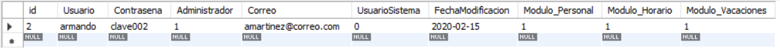
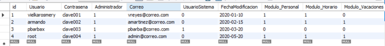
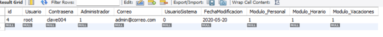
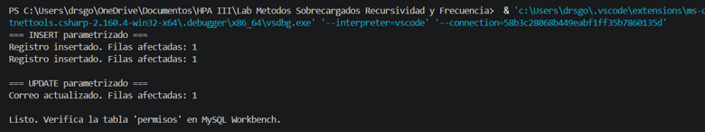
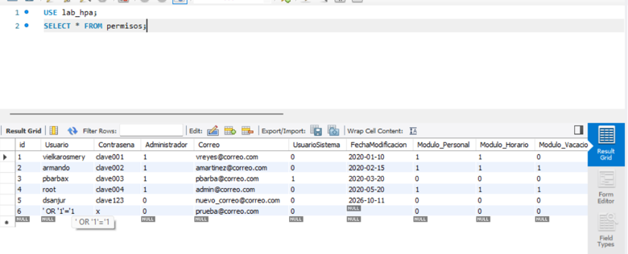
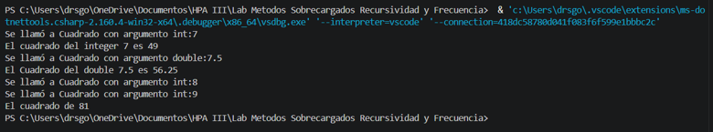
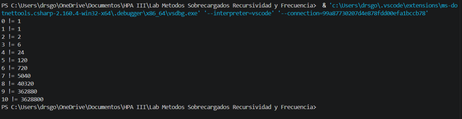
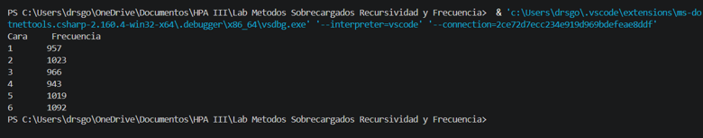

# Laboratorio HPA III — Inyección SQL, Consultas Parametrizadas, Sobrecarga, Recursividad y Frecuencias

Resolución de cinco problemas en torno a la seguridad y los fundamentos de la programación en C# y MySQL: tres consultas que demuestran la vulnerabilidad de inyección SQL, un ejemplo de consultas parametrizadas como defensa, y tres casos de estudio sobre sobrecarga de métodos, recursividad y contadores de frecuencia, desarrollados como aplicaciones de consola con .NET en Visual Studio Code.

**Universidad Tecnológica de Panamá** — Facultad de Ingeniería de Sistemas Computacionales
Herramientas de Programación Aplicada III (.Net) · Grupo 1IL133 · II Semestre 2026

- **Estudiante:** Diego Sanjur
- **Facilitadora:** Ing. Irina Fong

---

## Descripción

Este repositorio reúne los cinco problemas del laboratorio. Los dos primeros tratan la seguridad en el acceso a bases de datos: el Problema 1 reproduce en MySQL tres consultas que demuestran cómo una sentencia construida concatenando la entrada del usuario puede ser manipulada mediante inyección SQL, y el Problema 2 implementa en C# la defensa recomendada por OWASP, las consultas parametrizadas, mostrando que la misma entrada maliciosa queda neutralizada y se almacena como un dato literal. Los tres problemas restantes son aplicaciones de consola independientes: una simula 6000 lanzamientos de un dado y cuenta cuántas veces sale cada cara, otra demuestra la sobrecarga de métodos con dos versiones del método `Cuadrado`, y la última calcula el factorial de los números del 0 al 10 mediante recursividad.

Cada caso en C# se implementa como un proyecto separado porque un proyecto de consola admite un solo punto de entrada: algunos usan instrucciones de nivel superior (*top-level statements*), mientras que otros declaran su propio método `Main`.

## Estructura del repositorio

```
.
├── ConsultasParametrizadas/
│   ├── Conexion.cs           Clase que entrega la conexión a MySQL
│   ├── PermisoDAO.cs         Métodos Insert y Update parametrizados
│   └── Program.cs            Prueba las operaciones parametrizadas
├── SobreCargaMetodos/
│   ├── SobreCarga.cs         Clase con los métodos Cuadrado sobrecargados
│   └── Program.cs            Instancia la clase y prueba los métodos
├── Factorial/
│   └── Program.cs            Cálculo recursivo del factorial del 0 al 10
├── Frecuencias/
│   └── Program.cs                 Simulación de 6000 tiros de un dado
├── capturas/                      Capturas de resultados de cada problema
├── lab_hpa_permisos.sql           Script de creación de la tabla y datos de prueba
└── Problema1 - ConsultasSQL.sql   Los 3 casos de inyección SQL
```

---

## Problema 1: Consultas SQL — Inyección (3 casos)

Este problema se trabaja completamente en **MySQL** (sin C#) y demuestra por qué es peligroso construir una consulta concatenando directamente lo que el usuario escribe. Sobre una tabla de prueba `permisos`, se ejecutan tres consultas: una legítima y dos con entradas maliciosas que alteran la lógica de la sentencia.

**Preparación de la base de datos y datos de prueba**

```sql
CREATE DATABASE IF NOT EXISTS lab_hpa;
USE lab_hpa;

DROP TABLE IF EXISTS permisos;
CREATE TABLE permisos (
    id                 INT AUTO_INCREMENT PRIMARY KEY,
    Usuario            VARCHAR(50)  NOT NULL,
    Contrasena         VARCHAR(100) NOT NULL,
    Administrador      TINYINT(1)   DEFAULT 0,
    Correo             VARCHAR(100),
    UsuarioSistema     TINYINT(1)   DEFAULT 0,
    FechaModificacion  DATE,
    Modulo_Personal    TINYINT(1)   DEFAULT 0,
    Modulo_Horario     TINYINT(1)   DEFAULT 0,
    Modulo_Vacaciones  TINYINT(1)   DEFAULT 0
);

INSERT INTO permisos
    (Usuario, Contrasena, Administrador, Correo, UsuarioSistema, FechaModificacion,
     Modulo_Personal, Modulo_Horario, Modulo_Vacaciones)
VALUES
    ('vielkarosmery', 'clave001', 1, 'vreyes@correo.com',    0, '2020-01-10', 1, 1, 0),
    ('armando',       'clave002', 1, 'amartinez@correo.com', 0, '2020-02-15', 1, 1, 1),
    ('pbarbax',       'clave003', 1, 'pbarba@correo.com',    1, '2020-03-20', 0, 0, 0),
    ('root',          'clave004', 1, 'admin@correo.com',     0, '2020-05-20', 1, 1, 1);
```

**Caso 1 — Consulta normal (login legítimo)**

Representa lo que el programador pretendía: busca al usuario cuyo nombre y contraseña coinciden, y devuelve una sola fila.

```sql
SELECT * FROM permisos
WHERE Usuario = 'armando' AND Contrasena = 'clave002';
```



**Caso 2 — Inyección con `OR '1'='1'`**

Si el atacante escribe `' or '1'='1` en los campos del formulario, la consulta queda así. Como `'1'='1'` siempre es verdadero y se usa `OR`, la condición se cumple para todas las filas y se expone la tabla completa.

```sql
SELECT * FROM permisos
WHERE Usuario = '' OR '1'='1' AND Contrasena = '' OR '1'='1';
```



**Caso 3 — Inyección con comentario (`--`)**

El atacante escribe `root'; --` en el campo usuario. La comilla cierra el texto antes de tiempo, el punto y coma indica fin de instrucción, y los dos guiones comentan el resto de la línea, anulando por completo la validación de la contraseña. El motor solo ejecuta `WHERE Usuario='root'` y entrega el registro sin pedir clave.

```sql
SELECT * FROM permisos
WHERE Usuario = 'root'; -- ' AND Contrasena = 'mypassword';
```



**Conceptos:** inyección SQL, concatenación insegura de consultas, lógica booleana `OR '1'='1'`, comentarios SQL (`--`), impacto en la confidencialidad de los datos.

## Problema 2: Cadenas (Insert / Update) con Consultas Parametrizadas

Este problema implementa en C# la defensa contra la inyección SQL demostrada en el Problema 1. En lugar de concatenar la entrada del usuario dentro de la sentencia, se usan parámetros con marcadores (`@usuario`, `@correo`, …); la librería envía la consulta y los valores por separado, de modo que el motor trata la entrada siempre como un dato literal y nunca como código ejecutable. La solución se organiza en dos clases para separar la responsabilidad de conectarse de la de operar sobre los datos.

La clase `Conexion` guarda la cadena de conexión y entrega un objeto `MySqlConnection` listo para usar. La clase `PermisoDAO` contiene los métodos `InsertarPermiso` y `ActualizarCorreo`; ambos definen el `CommandText` con marcadores, agregan los parámetros a la colección del comando, llaman a `Prepare()` y ejecutan con `ExecuteNonQuery()` dentro de un bloque `try/catch (MySqlException)` que captura cualquier fallo de la base de datos. En el `UPDATE`, el `WHERE` también va parametrizado, por lo que no es posible inyectar `' OR '1'='1` para afectar toda la tabla.

En `Program.cs` se realiza una inserción normal, una inserción con el texto malicioso `' OR '1'='1` y una actualización de correo. La prueba clave es que el texto malicioso se almacena literalmente como un nombre de usuario más: no altera la consulta ni afecta otras filas, lo que confirma que las consultas parametrizadas neutralizan el ataque.

```csharp
cmd.CommandText =
    "INSERT INTO permisos (Usuario, Contrasena, Correo, Administrador) " +
    "VALUES (@usuario, @contrasena, @correo, 0)";

cmd.Parameters.AddWithValue("@usuario", usuario);
cmd.Parameters.AddWithValue("@contrasena", contrasena);
cmd.Parameters.AddWithValue("@correo", correo);

cmd.Prepare();
cmd.ExecuteNonQuery();
```





**Conceptos:** consultas parametrizadas / preparadas, `MySqlCommand`, marcadores de parámetros, `Prepare()`, `AddWithValue`, `ExecuteNonQuery()`, manejo de excepciones con `MySqlException`, separación de responsabilidades en clases.

**Diagrama UML**

```
┌────────────────────────────────────────────┐        ┌────────────────────────────────────────────┐
│                 Conexion                   │        │                PermisoDAO                  │
├────────────────────────────────────────────┤        ├────────────────────────────────────────────┤
│ - strConnection: string                    │        │ - conexion: Conexion                       │
├────────────────────────────────────────────┤        ├────────────────────────────────────────────┤
│ + ObtenerConexion(): MySqlConnection        │        │ + InsertarPermiso(usuario, contrasena,     │
└────────────────────────────────────────────┘        │                   correo): void            │
                                                       │ + ActualizarCorreo(usuario,                │
                                                       │                    nuevoCorreo): void      │
                                                       └────────────────────────────────────────────┘
```

## Problema 3: Sobrecarga de Métodos

La clase `SobreCarga` declara dos métodos con el mismo nombre, `Cuadrado`, que se diferencian por el tipo de su parámetro: uno recibe un `int` y devuelve un `int`, y el otro recibe un `double` y devuelve un `double`. Cada versión imprime un mensaje indicando cuál fue llamada antes de devolver el resultado.

El método `ProbarMetodosSobreCargados` llama a `Cuadrado(7)` y a `Cuadrado(7.5)`. El compilador decide qué versión ejecutar según el tipo del argumento: el literal `7` es entero y selecciona la versión `int`, mientras que `7.5` es un `double` y selecciona la otra. Esta decisión se toma en tiempo de compilación a partir de la firma del método (su nombre junto con el número, tipo y orden de los parámetros); el tipo de retorno no forma parte de la firma.

En `Program.cs` se crea un objeto `SobreCarga`, se ejecuta el método de prueba y luego se llama directamente a `Cuadrado(8)` y `Cuadrado(9)`. La llamada con 8 muestra el mensaje del método, pero su resultado (64) se descarta porque no se asigna ni se imprime; la llamada con 9 sí muestra el resultado, 81.

**Conceptos:** sobrecarga de métodos, firma de un método, resolución de sobrecarga en tiempo de compilación, métodos de instancia, espacios de nombres con ámbito de archivo, directiva `using`.



**Diagrama UML**

```
┌────────────────────────────────────────────┐
│                SobreCarga                  │
├────────────────────────────────────────────┤
├────────────────────────────────────────────┤
│ + ProbarMetodosSobreCargados()             │
│ + Cuadrado(valorInt: int): int             │
│ + Cuadrado(valorDouble: double): double    │
└────────────────────────────────────────────┘
```

## Problema 4: Recursividad (Factorial)

La clase `Program` contiene el método `Main`, que recorre los valores del 0 al 10 con un ciclo `for` y muestra el factorial de cada uno. El cálculo lo realiza el método estático `Factorial`, que se llama a sí mismo.

El método tiene un caso base: si el número es menor o igual a 1, devuelve 1 sin hacer más llamadas, lo que cubre tanto 0! como 1!. En cualquier otro caso aplica el paso de recursividad, devolviendo el número multiplicado por el factorial del número anterior. Cada llamada reduce el problema hasta llegar al caso base, y entonces los resultados se multiplican al regresar por la pila de llamadas. Se usa el tipo `long` porque los factoriales crecen muy rápido: 10! ya vale 3 628 800.

**Conceptos:** recursividad, caso base, paso recursivo, pila de llamadas, métodos estáticos, tipo `long`.



**Diagrama UML**

```
┌────────────────────────────────────────────┐
│                 Program                    │
├────────────────────────────────────────────┤
├────────────────────────────────────────────┤
│ + <<static>> Main(args: string[])          │
│ + <<static>> Factorial(numero: long): long │
└────────────────────────────────────────────┘
```

## Problema 5: Frecuencias (Contadores)

El programa crea un objeto `Random` y declara seis variables contadoras, una por cada cara del dado, todas inicializadas en cero. Un ciclo `for` se repite 6000 veces; en cada vuelta, `Next(1, 7)` genera un número entre 1 y 6 (el límite superior es exclusivo) que se guarda en la variable `cara`. Una estructura `switch` evalúa ese valor e incrementa el contador correspondiente; el caso `default` nunca debería ejecutarse, pero queda como protección ante un valor fuera de rango.

Al terminar el ciclo se imprime una tabla con cada cara y su frecuencia usando formato compuesto, con `\t` para tabular y `\n` para separar las filas. Como los números son aleatorios, los resultados cambian en cada ejecución, aunque cada cara tiende a aparecer cerca de 1000 veces.

**Conceptos:** generación de números aleatorios con `Random`, contadores, ciclo `for`, estructura `switch`, operador de incremento `++`, secuencias de escape, formato compuesto.


